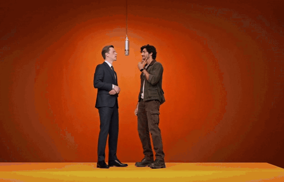

<p align="center"></p>

<h1 align="center">Rigless</h1>

<p align="center"><b>Swap anyone in a clip for your character. No rig, no prompt.</b></p>

<p align="center"></p>

Rigless is an open-source app that replaces one or more people in real footage with the
character in your pictures. You click the person. Everything else in the shot, including
the scene, the camera, the light and the other people, comes from your footage, not from
a prompt. It uses open weights only, with
[MiniMax H3](https://huggingface.co/MiniMaxAI/MiniMax-H3) as the core model, and runs
through the [Comfy SDK](https://pypi.org/project/comfy-sdk/) on a GPU you choose.

Built for Comfy's [#OpenSourceHiggsfield](https://comfy.org/open-source-higgsfield)
challenge, as an open answer to Higgsfield's Genjutsu.

## What makes it different

- **The scene stays as filmed.** H3 redraws only inside each tracked person's mask.
  Everywhere else it keeps your clip's own latents, so the scene and the other people
  come from your footage. Takes come out at H3's resolution, about 1 megapixel at Full.
- **Its own LoRA, trained on real footage.** The Rigless LoRA fine-tunes akatz's
  Character Swap LoRA for H3 Relay. It reads your character's pictures closely and
  matches the light in your footage. See [The Rigless LoRA](#the-rigless-lora).
- **No prompt needed.** An open vision model, Qwen3-VL 8B, describes your character from
  their pictures. It also lists what the performer has that the character doesn't ("no
  rings, no watch"), so H3 doesn't copy those over. You can add a prompt of your own.
- **Every take is measured.** Each take gets a motion score from 0 to 100 against the
  original performance. Frozen and mirrored takes are flagged, and the best take is
  marked for you.
- **Click, don't mask.** Click a person and SAM 3.1 tracks them through the clip. A
  preview shows where it lost them. Add up to three people, each with their own
  character, and one pass swaps them all.
- **Bring your own GPU.** Deploy a RunPod GPU from inside the app with your own key, use
  your own NVIDIA GPU, or connect to a ComfyUI server anywhere else.

## Examples

**Two people, one pass.** A 16 second clip, Full (768p), one take, motion score 89.8.
The only prompt was "@2 has a monocle." Everything else came from the pictures.

https://github.com/user-attachments/assets/d2343008-aa1e-4722-a5d2-c4b937d123fd

**Into the crowd.** A 20 second clip, Full (768p), motion score 84.2, with no prompt at
all. It opens on a close-up, then the person turns and walks away into a crowd, and
everyone around them stays as filmed.

https://github.com/user-attachments/assets/0736a051-c4dd-43d9-9acb-de7f73bae9a1

**Seen from behind.** A 9 second runway dance, Full (768p), motion score 85.1, with
this prompt: "@1 dances down the runway away from the camera, toward the crowd.
Whenever the original person has their back to the camera, @1 has their back to the
camera too: we see the back of their clothes and the back of their head, never their
face. When they spread their arms wide, they still face the crowd, away from the
camera." Without it, 2 of 3 takes turned the dancer toward the camera for about a
second when the arms spread wide. With it, both seeds tried held.

https://github.com/user-attachments/assets/c50f39f7-2e49-400a-a4a2-f6ff7f4c9f15

## Using it

1. **Drop a clip** of up to 2 minutes and trim it to the part you want, up to 20 seconds.
2. **Click the person** you want to replace and check the tracking preview. If it lost
   them, for example after a camera cut, tap them again on that frame. A new tap fixes
   the tracking from that frame on. To pick someone else, tap them on the same frame, or
   press **Clear taps** on the person's card. Press **+ Add person** to swap more than
   one.
3. **Add the character.** Use a character sheet or a few pictures. A front view, a
   close-up of the face and a back view work best. One picture must show the whole body,
   head to toe. A sheet with several figures on a plain background is cut into separate
   views. A picture of one person is used as it is. Small details such as a monocle need
   the close-up, because from a single front photo they can come out wrong.
4. **Generate** a **Draft** (480p, about 2.5x faster, for checking the casting and the
   motion) or a **Full** take (768p). Every take is kept, so you can compare them and
   download the best one.

The first render asks you to agree to MiniMax H3's terms. See
[Responsible use](#responsible-use).

## Install

You need [uv](https://docs.astral.sh/uv/) and git. The app runs on Windows, macOS or
Linux. Rendering needs a GPU with **48 GB or more** (tested on an H100 80 GB) and a
driver for **CUDA 13**.

```bash
git clone https://github.com/StephenShumway/rigless
cd rigless
uv sync
uv run rigless
```

The app opens in your browser at `http://127.0.0.1:8190` and only listens on your own
computer. Use the button at the top right to choose where it renders.

### RunPod (easiest)

1. Make a [RunPod](https://www.runpod.io/) account, add credit, and create an API key.
2. In the app, choose **RunPod**, paste the key, pick a GPU, and press **Deploy**. The key
   stays in your browser. Rigless rents a GPU in your account and installs ComfyUI, the
   models (about 67 GB) and a token-protected connection. The first setup takes about 5
   minutes in a fast data center and longer in a slow one (RunPod picks which). The app
   shows the progress and the time left.
3. **Pause** when you're done. RunPod stops billing for the GPU and keeps the pod's 100 GB
   disk, with ComfyUI and the models, for about $0.03 an hour. **Resume** brings it back
   if the GPU on its machine is free. Resume keeps the models but reinstalls the Python
   environments, because a pause clears the container disk they live on. **Delete**
   removes the pod and its disk.

### This Computer

For an NVIDIA GPU with 48 GB or more in your own machine:

1. Install [ComfyUI](https://github.com/Comfy-Org/ComfyUI) **v0.41.2** with PyTorch for
   CUDA 13 (`cu130`) and add `scipy` to its environment. Put the
   [H3 Relay](https://github.com/akatz-ai/h3-relay) nodes in its `custom_nodes` folder.
   The commit Rigless was tested with is pinned in `deploy/runpod/setup.sh`.
2. Download the models (about 67 GB) into ComfyUI's models folder:
   `uv run python scripts/download_models.py --models-dir /path/to/ComfyUI/models`
3. Start ComfyUI, then start the proxy that Rigless talks to:
   `uv run comfy-api-proxy start --comfyui http://127.0.0.1:8188`
   The proxy listens on `127.0.0.1:8189`.
4. In the app, choose **This Computer**.

On Linux, `deploy/runpod/setup.sh` does all of this and is the exact recipe.

### Custom (any other GPU server)

On any Linux machine with a suitable GPU, such as another cloud or a lab server, clone
this repo and run `PROXY_TOKEN=<a long random value> bash deploy/runpod/setup.sh` as
root. It puts ComfyUI and the models under `/workspace` and the Python environments under
`/opt`. Then it starts the proxy on port 8189, protected by that token.

The proxy speaks plain HTTP, and the token goes with every request. Before it leaves a
private network, put it behind HTTPS with a reverse proxy such as Caddy, or a tunnel.
Then copy `.env.example` to `.env` in your local copy of Rigless and fill in two lines:

```bash
COMFY_BASE_URL=https://your-server     # the HTTPS address in front of the proxy
COMFY_API_KEY=<the same token>         # what the proxy checks on every request
```

These are the Comfy SDK's standard names. `COMFY_API_KEY` is only needed because the
proxy has a token. A proxy started without one needs only `COMFY_BASE_URL`, and that is
only sensible on a private network. Restart Rigless and it renders there, shown as
**Custom**. To go back to RunPod or This Computer, remove the two lines.

## How it works

1. **Footage.** The trimmed part is converted to a steady 24 fps, H3's frame rate, so
   every step counts the same frames.
2. **Tracking.** Your clicks go to SAM 3.1 in ComfyUI, which tracks each person through
   the clip. If a mask covers only part of a body, Rigless adds taps on the body and
   tracks again.
3. **Describing.** Qwen3-VL 8B describes the character's appearance from all their
   pictures. It never describes pose or expression, because H3 would act them out. It
   compares the character with the performer to list what the character doesn't have,
   and it checks that the pictures and footage are safe for work.
4. **Swapping.** MiniMax H3 redraws each person inside their mask, grown by a margin for
   hair and clothes. It works in overlapping windows, with the clip as `<Video 1>` and
   the pictures as `<Picture 1>` to `<Picture N>`. Outside the masks, H3 keeps the clip's
   own latents. It runs with an 8-step Turbo LoRA and the Rigless LoRA. It also hears the
   clip's sound, so mouths move with the song or speech.
5. **Finishing.** The take gets the clip's own sound back, and its metadata marks it as
   AI-generated.
6. **Scoring.** RTMPose finds the performer's pose in the clip and the character's pose
   in the take, inside the same boxes, and compares limb directions frame by frame. A
   take that barely moves is flagged as frozen. A take that moves like a mirror image is
   flagged as mirrored. The best take is the best one without a flag, and Full takes
   rank above Drafts.

The ComfyUI workflows Rigless runs are in [`workflows/`](workflows/) as API-format JSON:
the H3 swap, SAM 3.1 tapping and tracking, and the Qwen3-VL describer. Drag one into
ComfyUI and point its placeholder inputs (`input.mp4`, `masks.mp4`, `picture_1.png` and
so on) at your own files. `scripts/export_workflows.py` regenerates them from the code.
The swap needs the H3 Relay nodes. ComfyUI Manager lists them as an unknown pack, so
install them by hand as in step 1 of [This Computer](#this-computer).

## Models and tools

| What | Used for | License |
|---|---|---|
| [MiniMax H3](https://huggingface.co/Comfy-Org/MiniMax-H3) (ref2va pruned int8, video and audio VAEs) | The swap | [MiniMax H3 Community License](https://huggingface.co/MiniMaxAI/MiniMax-H3/blob/main/LICENSE) |
| Qwen3-VL-32B, H3's text encoder (int8, in the same repo) | Reading H3's prompt | Apache-2.0 (per the MiniMax H3 license's note) |
| [H3 Turbo LoRA](https://huggingface.co/lightx2v/Minimax-h3-Turbo) (FL2V 8-step, 768p) | Sampling in 8 steps | MiniMax H3 Community License, as an H3 derivative |
| [Rigless LoRA](https://huggingface.co/StephenShumway/rigless-lora) | The swap, fine-tuned on real footage | MiniMax H3 Community License |
| [Character Swap LoRA v1.5](https://huggingface.co/akatz-ai/MiniMax-H3-Character-Swap-LoRA) by akatz | What the Rigless LoRA was fine-tuned from | MiniMax H3 Community License |
| [H3 Relay](https://github.com/akatz-ai/h3-relay) nodes by akatz | Masked, windowed H3 rendering | GPL-3.0, installed separately in ComfyUI |
| [SAM 3.1](https://huggingface.co/Comfy-Org/sam3.1) | Tracking the people you click | [SAM License](https://huggingface.co/Comfy-Org/sam3.1/blob/main/LICENSE) |
| Qwen3-VL 8B ([Comfy-Org/Qwen-Image-2.1](https://huggingface.co/Comfy-Org/Qwen-Image-2.1), `text_encoders`) | The description, the "has no" list, the safety check | [Qwen Research License](https://huggingface.co/Qwen/Qwen-Image-2.1/blob/main/LICENSE), for research and evaluation only |
| [rtmlib](https://github.com/Tau-J/rtmlib) with RTMPose and YOLOX | Poses for scoring and the tracking checks, views on sheets | Apache-2.0. The weights come from OpenMMLab's [MMPose](https://github.com/open-mmlab/mmpose) (Apache-2.0) and were trained on public datasets with their own terms. |
| [ComfyUI](https://github.com/Comfy-Org/ComfyUI) | Running the models | GPL-3.0, a separate program |
| [Comfy SDK](https://github.com/Comfy-Org/comfy-python-sdk), [comfy-api-proxy](https://github.com/Comfy-Org/comfy-api-proxy) | Talking to ComfyUI | MIT |
| [imageio-ffmpeg](https://github.com/imageio/imageio-ffmpeg) | Video in and out (it bundles an FFmpeg build) | BSD-2-Clause. The FFmpeg build it bundles is under the GPL and runs as a separate program. |
| [IBM Plex](https://github.com/IBM/plex) Sans and Mono | The app's fonts, bundled | SIL Open Font License 1.1 (`src/rigless/web/fonts/OFL.txt`) |

The Qwen3-VL 8B file is under Qwen's research license, not the Apache-2.0 license of the
main Qwen3-VL release. So the describer as shipped is for non-commercial use only.

## The Rigless LoRA

`rigless-lora-v1.safetensors` is on Hugging Face at
[StephenShumway/rigless-lora](https://huggingface.co/StephenShumway/rigless-lora).
Rigless downloads it with the other models.

It fine-tunes akatz's H3 Relay Character Swap LoRA v1.5 on real footage. Each training
sample is a real clip with someone else swapped in by H3. The LoRA learns to turn that
back into the real person, given only a picture of them. The target is always real
footage, so it learns real light and has to read the picture to know who to draw.

In a blind test it was preferred over v1.5 and over no swap LoRA (3 clips, one take each,
judged by its developer). It is not measurably better at face identity. On the runway
dance in [Examples](#examples), with the same seed and the same prompt, v1.5 turned the
dancer toward the camera for about a second and the Rigless LoRA didn't (motion score
77.4 against 85.1). [Watch the side-by-side](examples/lora-vs-v1.5.mp4).

### Compare with v1.5

Download `h3_character_swap_v1.5.safetensors` from
[akatz-ai/MiniMax-H3-Character-Swap-LoRA](https://huggingface.co/akatz-ai/MiniMax-H3-Character-Swap-LoRA)
into ComfyUI's `models/loras` folder. Then set `SWAP_LORA` in `src/rigless/swap.py` to
that file name.

## Limitations

- One take covers up to 20 seconds of footage and up to three people.
- Takes come out at H3's resolution, about 1 megapixel at Full (for example 1248x800 for
  a landscape clip). The background is a little softer than your footage and can be
  slightly off in color.
- H3 takes up to nine pictures in all. With several people, the pictures are shared
  between them in turn.
- The GPU needs 48 GB or more. Only the H100 (80 GB) has been tested.
- Small accessories need a close-up of the face. From a single front photo they can come
  out wrong, for example a monocle drawn as glasses.
- After a camera cut, SAM can lose the person or follow someone else. Check the preview
  and tap again.
- Someone seen from behind can be turned toward the camera for a moment, especially
  in a pose that looks the same from both sides, such as arms spread wide. In testing,
  a prompt that names what they face toward fixed it, where a general one didn't: "@1
  dances down the runway away from the camera, toward the crowd. Whenever the
  original person has their back to the camera, @1 has their back to the camera too.
  When they spread their arms wide, they still face the crowd, away from the camera."
  The motion score drops on a take where they turned, so it's easy to spot.

## Responsible use

Rigless renders with MiniMax H3, licensed under the
[MiniMax H3 Community License Agreement](https://huggingface.co/MiniMaxAI/MiniMax-H3/blob/main/LICENSE).
Before the first render, the app shows its terms and asks you to agree. Among other
things, they ask you to:

- use only footage and pictures you have the rights to, of people who consented or who
  aren't real
- never impersonate, harass, deceive or harm anyone
- say clearly that a video is AI-generated wherever you share it
- never use H3's output to train another AI model

MiniMax H3 can't be used in the United States, the European Union, the United Kingdom or
South Korea without your own
[authorization from MiniMax](https://platform.minimax.io/h3-license).

Report misuse: [pickax-diamond0s@icloud.com](mailto:pickax-diamond0s@icloud.com)

## For developers

```bash
uv sync
uv run ruff format .
uv run ruff check . --fix
uv run mypy
uv run pytest
```

Tests that need a running ComfyUI carry the `comfy` marker. Tests that need the local
test videos carry `fixtures`. Both skip cleanly when those are missing.

Settings go in `.env` at the repo root and are all optional (see `.env.example`):

| Variable | What it does |
|---|---|
| `COMFY_BASE_URL` | The comfy-api-proxy address of a ComfyUI anywhere else. Overrides the choice in the app. |
| `COMFY_API_KEY` | That proxy's bearer token, if it has one. |

| Module | Role |
|---|---|
| `app.py` | The web app and its API |
| `projects.py` | Shoots: footage, people, pictures, renders and takes |
| `selection.py` | Tracking the clicked people with SAM 3.1 |
| `sheet.py` | Finding the views on a character sheet |
| `describe.py` | Qwen3-VL: the description, the "has no" list, the safety check |
| `swap.py` | The H3 swap graph and rendering |
| `pose.py`, `score.py` | Pose estimation and the motion score |
| `video_prep.py` | ffmpeg and OpenCV helpers |
| `comfy_client.py`, `config.py` | The connection to ComfyUI |
| `runpod.py` | Deploying and managing the RunPod GPU |
| `terms.py` | The MiniMax H3 terms each user agrees to |

## License

The code is under the [Apache License 2.0](LICENSE). The models are under their own
licenses (see [Models and tools](#models-and-tools)). The Rigless LoRA is a derivative of
MiniMax H3 and is under the MiniMax H3 Community License Agreement.
